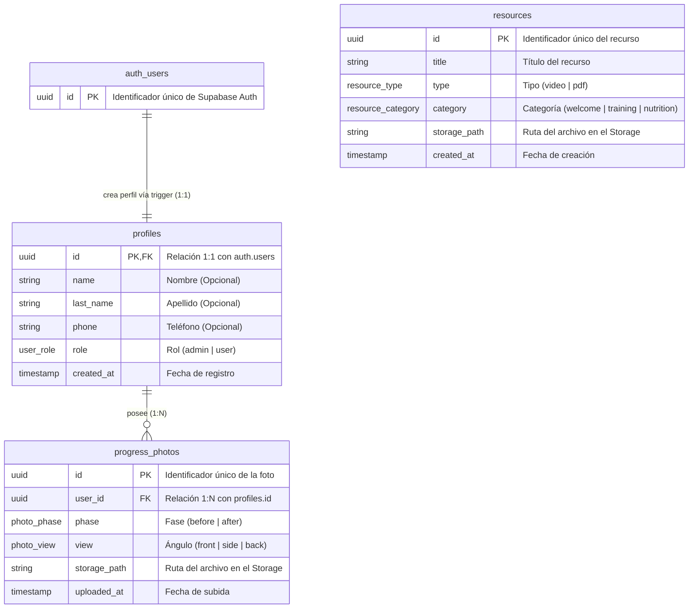

# Top Shape - Plataforma de Coaching y Transformación Física

¡Bienvenido al repositorio central de **Top Shape**! Este archivo sirve como el **mapa de ruta y guía contextual definitiva** para que puedas seguir desarrollando en tu notebook sin perderte de nada. Acá vas a encontrar todo lo que necesitás saber sobre la arquitectura, la base de datos, el storage, las decisiones de diseño tomadas y cómo levantar el entorno local en dos minutos.

---

## 📌 1. ¿De qué trata Top Shape?

**Top Shape** es una plataforma de coaching y transformación física diseñada para gestionar el progreso de participantes de forma visual, segura y estructurada.

### Flujos Clave del Sistema:
*   **Registro Simplificado & Perfil Diferido**: El usuario se registra al toque usando solo email y contraseña. El perfil se autocrea en base de datos gracias a un trigger, dejando campos opcionales (`name`, `last_name`, `phone`) para que los complete en su primer ingreso.
*   **Control Físico Estricto (Matriz de Progreso)**: Los participantes suben exactamente **6 fotos** representativas de su evolución (2 fases: *Antes/Después* x 3 ángulos: *Frente/Perfil/Espalda*).
*   **Recursos Dinámicos**: Los participantes consumen guías en PDF y videos educativos subidos de manera dinámica por el Administrador.

---

## 🧱 2. Arquitectura General y Flujo de Datos

El sistema implementa una arquitectura basada en un **Frontend SPA (Single Page Application)** conectada de forma directa y segura a un backend serverless provisto por **Supabase (Backend-as-a-Service - BaaS)**.

```text
React (Vite / Frontend SPA)
       │
       ▼
Supabase Auth (Gestión de Sesiones, JWT y Registro)
       │
       ▼
PostgreSQL (Supabase Database - Datos Estructurados y RLS)
       │
       ▼
Supabase Storage (Almacenamiento de Recursos y Evolución Física)
```

> [!NOTE]
> Al delegar la autenticación y persistencia en Supabase mediante políticas de acceso a nivel de fila (**RLS - Row Level Security**), no necesitamos un servidor backend intermedio para operaciones comunes, garantizando velocidad y seguridad desde el primer día.

---

## 📁 3. Estructura del Repositorio

El proyecto está organizado de manera limpia y modular en la raíz:

```text
TopShape/
├── docs/                 # Documentación de diseño, ADRs, base de datos y storage
├── supabase/             # Entorno local de Supabase (configuración, migraciones y seeds)
└── top-shape/            # Frontend SPA (React + Vite + TypeScript)
```

### Arquitectura Modular basada en Features (`top-shape/src/features/`)
Dentro de la aplicación React, el código no se organiza por "tipo de archivo técnico" sino por funcionalidad del negocio:
*   **`auth/`**: Formularios de login, registro, recuperación de credenciales y estado de sesión.
*   **`profile/`**: Edición de datos personales del participante.
*   **`progress/`**: Carga y visualización de la cuadrícula de fotos de progreso de control físico.
*   **`resources/`**: Galería de videos y PDFs (organizados en welcome, training, nutrition) con su panel de gestión para admins.

---

## 💾 4. Modelo de Datos y Base de Datos (PostgreSQL)

La base de datos relacional se gestiona en **PostgreSQL** mediante Supabase.

### Diagrama Entidad-Relación (ERD)



### Reglas de Integridad & Seguridad Críticas:
1.  **Tipos ENUM**: Aseguran consistencia estricta en base de datos (`user_role`, `photo_phase`, `photo_view`, `resource_type`, `resource_category`).
2.  **Unicidad Compuesta**: La tabla `progress_photos` tiene una restricción `UNIQUE(user_id, phase, view)`, lo que impide subir fotos duplicadas para una misma fase y perspectiva.
3.  **Trigger de Autoregistro**: El trigger `handle_new_user()` crea una fila en `profiles` inmediatamente tras el alta de un usuario en `auth.users` de manera transaccional.
4.  **Función `public.is_admin()`**: Centraliza la validación de privilegios de administrador de forma segura mediante `SECURITY DEFINER` evitando recursión en políticas RLS.
5.  **Row Level Security (RLS)**: Activado en todas las tablas. Los participantes solo acceden a sus propios registros (`auth.uid() = user_id/id`). Los recursos son públicos para lectura de usuarios autenticados, pero la escritura se restringe a administradores.

---

## 📦 5. Almacenamiento (Supabase Storage)

El almacenamiento se organiza en buckets diferenciados:

*   **`progress-photos` (Privado)**: Aislado por UUID de usuario.
    ```text
    progress-photos/{user_id}/[before|after]/[front|side|back].jpg
    ```
    *   *Gotcha importante*: La base de datos almacena el `storage_path` relativo (ej. `{user_id}/before/front.jpg`) en lugar de URLs absolutas. El frontend pide URLs firmadas temporales al cliente de Supabase para evitar exponer imágenes privadas de forma permanente.
*   **`documents` (Lectura para Autenticados, Escritura Admin)**: PDFs de entrenamiento y nutrición.
*   **`videos` (Lectura para Autenticados, Escritura Admin)**: Videos de bienvenida (formato vertical 9:16) y explicativos.

---

## 🛠️ 6. Guía de Inicio Rápido (Notebook Setup)

Seguí estos pasos para levantar el proyecto local en tu notebook:

### Prerrequisitos:
1.  **Docker Desktop** (requerido para ejecutar Supabase CLI localmente).
2.  **NodeJS** (LTS recomendado).
3.  **pnpm** (instalalo de forma global con `npm install -g pnpm`).
4.  **Supabase CLI** (instalalo de forma global o local).

### Pasos para levantar el entorno:

1.  **Iniciar Base de Datos Local**:
    Parate en la raíz del proyecto y ejecutá:
    ```bash
    supabase start
    ```
    *Esto va a levantar PostgreSQL, Auth, Storage y Studio de Supabase en contenedores Docker locales.*

2.  **Vincular o Sincronizar Migraciones**:
    Si es la primera vez, verificá que las migraciones locales estén aplicadas:
    ```bash
    supabase db reset
    ```
    *Esto aplicará todas las migraciones SQL que se encuentran en `/supabase/migrations/` de forma secuencial y limpia.*

3.  **Instalar dependencias del Frontend**:
    Movelte a la carpeta de la SPA e instalá todo con pnpm:
    ```bash
    cd top-shape
    pnpm install
    ```

4.  **Configurar Variables de Entorno**:
    Asegurate de tener el archivo `top-shape/.env` con las variables apuntando a tu Supabase local (la consola de `supabase start` te las provee al terminar):
    ```env
    VITE_SUPABASE_URL=http://localhost:54321
    VITE_SUPABASE_ANON_KEY=tu_anon_key_local
    ```

5.  **Correr en Desarrollo**:
    Levantá el servidor local de Vite:
    ```bash
    pnpm run dev
    ```
    Abrí `http://localhost:5173` y ya estás listo para codear.

---

## 🗺️ 7. Estado del Roadmap

*   🟩 **Módulo 1: Base de Datos & Modelado**: Completado. Esquema físico, enums, triggers y RLS funcionando.
*   🟨 **Módulo 2: Storage (Almacenamiento)**: En progreso. Estructura conceptual definida, configurando buckets y políticas RLS del storage.
*   ⬜ **Módulo 3: Autenticación & Flujos**: Pendiente.
*   ⬜ **Módulo 4: Dashboards & UI**: Pendiente.
*   ⬜ **Módulo 5: Deploy**: Pendiente.

---

## 📌 8. Buenas Prácticas del Repositorio

*   **Base de Datos como Código**: Cualquier modificación a tablas, políticas RLS o triggers se hace **EXCLUSIVAMENTE** a través de migraciones de Supabase CLI en la carpeta `/supabase/migrations/`. ¡Nada de modificar a mano desde el dashboard web en producción!
*   **Gestión de Dependencias**: Usá siempre `pnpm` para instalar nuevos paquetes para evitar dependencias fantasma y ahorrar espacio.
*   **Arquitectura Modular**: Mantener la cohesión dentro de `src/features/`. Si creás lógica de negocio nueva, tiene que vivir en su feature correspondiente.
*   **Estilo Visual**: Respetar las variables globales de color definidas en `variables.css` que coinciden con el packaging oficial de Top Shape (primary teal `#007c89`, accent crimson red `#d1122a`).
