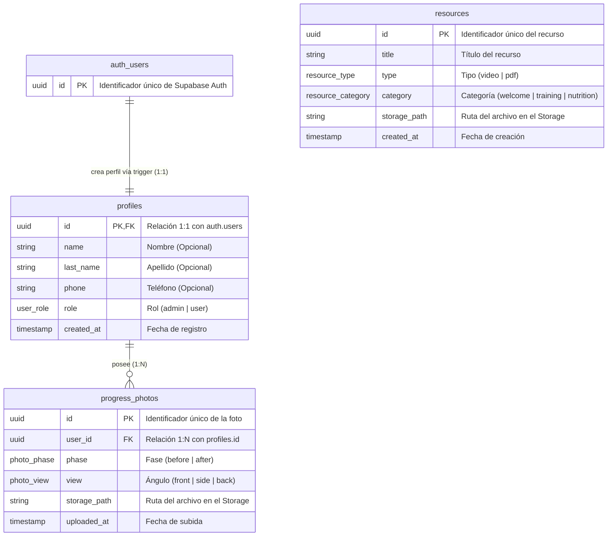

# Modelo y Diseño de Base de Datos - Top Shape

Este documento detalla el diseño definitivo de la base de datos relacional de **Top Shape**, implementada sobre **PostgreSQL** a través de **Supabase**. Se describen las tablas, tipos personalizados (ENUMs), restricciones, políticas de seguridad (RLS) y la infraestructura de desarrollo local.

---

## 1. Diagrama de Relaciones (ERD)

### Visualización Mermaid


### Visualización de Relaciones (ASCII)
```text
+------------------+          +-------------------+
|    auth.users    |          |     profiles      |
|  (Supabase Auth) |          |  (Tabla Perfiles) |
+--------+---------+          +---------+---------+
         |                              |
         | (1:1 relation via Trigger)   |
         +------------------------------+
                                        |
                                        | (1:N relation)
                                        v
                              +---------+---------+
                              |  progress_photos  |
                              |  (Fotos Progreso) |
                              +-------------------+

                              +-------------------+
                              |     resources     |
                              | (Recursos Estát.) |
                              +-------------------+
```

---

## 2. Tipos Personalizados (ENUMs)

Para asegurar la integridad de los datos a nivel físico en PostgreSQL, se utilizan los siguientes tipos enumerados:

### `user_role`
Niveles de acceso del sistema.
* `'admin'`: Entrenadores y administradores con privilegios totales.
* `'user'`: Participantes activos del programa.

### `photo_phase`
Representa el periodo de la transformación física del participante.
* `'before'`: Fotografías de control del inicio del programa.
* `'after'`: Fotografías de control del final del programa.

### `photo_view`
Define la perspectiva o ángulo visual de la captura de progreso.
* `'front'`: Vista frontal.
* `'side'`: Vista lateral (perfil).
* `'back'`: Vista trasera (de espalda).

### `resource_type`
Clasifica el formato del contenido estático.
* `'video'`: Material en formato de video (mp4).
* `'pdf'`: Documentación escrita, guías y rutinas (pdf).

### `resource_category`
Agrupa los recursos estáticos del sistema.
* `'welcome'`: Contenido introductorio.
* `'training'`: Ejercicios y guías de actividad física.
* `'nutrition'`: Planes de alimentación y guías nutricionales.

---

## 3. Tablas de la Base de Datos

### 3.1. Tabla: `profiles`
Contiene la información de perfil personal del usuario. Esta tabla extiende el esquema de autenticación nativo de Supabase.

| Campo | Tipo de Datos | Restricciones | Descripción |
|---|---|---|---|
| `id` | `UUID` | `PRIMARY KEY`, `FOREIGN KEY (auth.users)` | Identificador 1:1 vinculado con el usuario autenticado de Supabase Auth. |
| `name` | `VARCHAR(100)` | `NULL` | Nombre de pila (opcional en el registro inicial). |
| `last_name` | `VARCHAR(100)` | `NULL` | Apellido (opcional en el registro inicial). |
| `phone` | `VARCHAR(20)` | `NULL` | Teléfono de contacto. |
| `role` | `user_role` | `NOT NULL`, `DEFAULT 'user'` | Rol de acceso del usuario (`admin` o `user`). |
| `created_at` | `TIMESTAMPTZ` | `NOT NULL`, `DEFAULT now()` | Fecha de registro del perfil. |

> [!IMPORTANT]
> **Opcionalidad en el Registro**:
> Los campos `name` y `last_name` ya **NO** son obligatorios (`NOT NULL`) al crear el usuario. El sistema permite que el usuario se registre utilizando únicamente correo y contraseña, y complete su información de perfil en su primer ingreso a la aplicación.

---

### 3.2. Tabla: `progress_photos`
Registra las referencias de almacenamiento de las fotografías que demuestran la evolución física de cada participante.

| Campo | Tipo de Datos | Restricciones | Descripción |
|---|---|---|---|
| `id` | `UUID` | `PRIMARY KEY`, `DEFAULT gen_random_uuid()` | ID único del registro fotográfico. |
| `user_id` | `UUID` | `FOREIGN KEY (profiles.id)`, `NOT NULL` | ID del participante dueño de la foto. |
| `phase` | `photo_phase` | `NOT NULL` | Fase de la evolución (`before` o `after`). |
| `view` | `photo_view` | `NOT NULL` | Perspectiva de la toma (`front`, `side` o `back`). |
| `storage_path` | `TEXT` | `NOT NULL` | Ruta de almacenamiento relativa dentro de Supabase Storage. |
| `uploaded_at` | `TIMESTAMPTZ` | `NOT NULL`, `DEFAULT now()` | Fecha de subida de la imagen. |

#### Restricciones de Integridad
* **Clave Única Compuesta**: Se aplica la restricción `UNIQUE(user_id, phase, view)`. Un usuario solo puede subir una imagen para cada combinación, lo que da un total de **exactamente 6 fotografías** para completar su perfil de progreso:

```text
Before (Antes)
 ├── Front (Frente)
 ├── Side (Perfil)
 └── Back (Espalda)

After (Después)
 ├── Front (Frente)
 ├── Side (Perfil)
 └── Back (Espalda)
```

---

### 3.3. Tabla: `resources`
Catálogo de videos y PDFs educativos cargados por el equipo administrador.

| Campo | Tipo de Datos | Restricciones | Descripción |
|---|---|---|---|
| `id` | `UUID` | `PRIMARY KEY`, `DEFAULT gen_random_uuid()` | ID único del recurso. |
| `title` | `VARCHAR(255)` | `NOT NULL` | Nombre que se mostrará al participante. |
| `type` | `resource_type` | `NOT NULL` | Formato del recurso (`video` o `pdf`). |
| `category` | `resource_category` | `NOT NULL` | Clasificación temática (`welcome`, `training` o `nutrition`). |
| `storage_path` | `TEXT` | `NOT NULL` | Ruta relativa del archivo dentro de los buckets de almacenamiento. |
| `created_at` | `TIMESTAMPTZ` | `NOT NULL`, `DEFAULT now()` | Fecha de publicación del recurso. |

---

## 4. Seguridad y Reglas de Acceso (RLS)

El acceso a la base de datos se rige estrictamente mediante directivas del motor PostgreSQL.

### Row Level Security (RLS)
Todas las tablas del sistema poseen **RLS activado**. Esto significa que por defecto la base de datos deniega cualquier intento de consulta, inserción o edición a menos que existan políticas de acceso explícitas aplicadas al usuario solicitante.

### Políticas de Seguridad basadas en Contexto
Las reglas de acceso utilizan la sesión del usuario mediante la función integrada `auth.uid()`, garantizando aislamiento de datos:
* **Lectura de Perfiles**: Los usuarios pueden leer y editar únicamente su propia fila en la tabla `profiles` (`auth.uid() = id`). Los administradores pueden leer y editar todos los perfiles del sistema.
* **Fotos de Progreso**: Un usuario solo puede insertar y leer fotos que tengan asignado su propio identificador (`auth.uid() = user_id`).
* **Recursos**: Cualquier usuario autenticado tiene permisos de lectura para consumir los recursos (`welcome`, `training`, `nutrition`). La inserción y edición está denegada para participantes.

### Función SQL Auxiliar: `public.is_admin()`
Para delegar y centralizar la autorización de roles, se definió la siguiente función SQL en el esquema público:
```sql
CREATE OR REPLACE FUNCTION public.is_admin()
RETURNS boolean AS $$
BEGIN
  RETURN EXISTS (
    SELECT 1 FROM public.profiles
    WHERE id = auth.uid() AND role = 'admin'
  );
END;
$$ LANGUAGE plpgsql SECURITY DEFINER;
```
* **Propósito**: Comprobar de forma segura si el usuario que ejecuta la petición HTTP/SQL actual cuenta con el rol `'admin'`. Al ser declarada con `SECURITY DEFINER`, se ejecuta con los privilegios del creador de la función, permitiendo validar perfiles de forma transparente sin incurrir en recursión infinita en las políticas RLS.

### Automatización mediante Triggers: `handle_new_user()`
Para automatizar la creación del perfil del participante y agilizar el proceso de registro inicial (donde solo se solicita email y contraseña), se implementó un trigger en PostgreSQL:
```text
Usuario se registra en Supabase Auth
       │ (auth.users)
       ▼
Trigger handle_new_user()
       │
       ▼
Crea automáticamente fila en tabla profiles
- mismo UUID
- role = 'user'
- name = NULL, last_name = NULL
```
Este flujo garantiza que la tabla `profiles` se mantenga sincronizada con las cuentas de autenticación de Supabase de manera automática sin requerir peticiones adicionales desde el frontend.

---

## 5. Control de Versiones de Infraestructura (Supabase CLI)

El esquema físico de la base de datos está completamente configurado y versionado como código utilizando la infraestructura de desarrollo local de Supabase:
* **Entorno Local**: Configurado mediante **Supabase CLI** en conjunto con **Docker Desktop** para correr réplicas locales de PostgreSQL, Auth y Storage en contenedores.
* **Vinculación de Proyecto**: El repositorio se encuentra vinculado al proyecto en la nube a través del comando `supabase link`.
* **Versionado por Migraciones**: A partir de la finalización del Módulo 1, todos los cambios del esquema de la base de datos se realizarán obligatoriamente a través de archivos SQL de migración en la carpeta `supabase/migrations/`, permitiendo replicar el estado de desarrollo local en los entornos de staging o producción de manera confiable e incremental.
