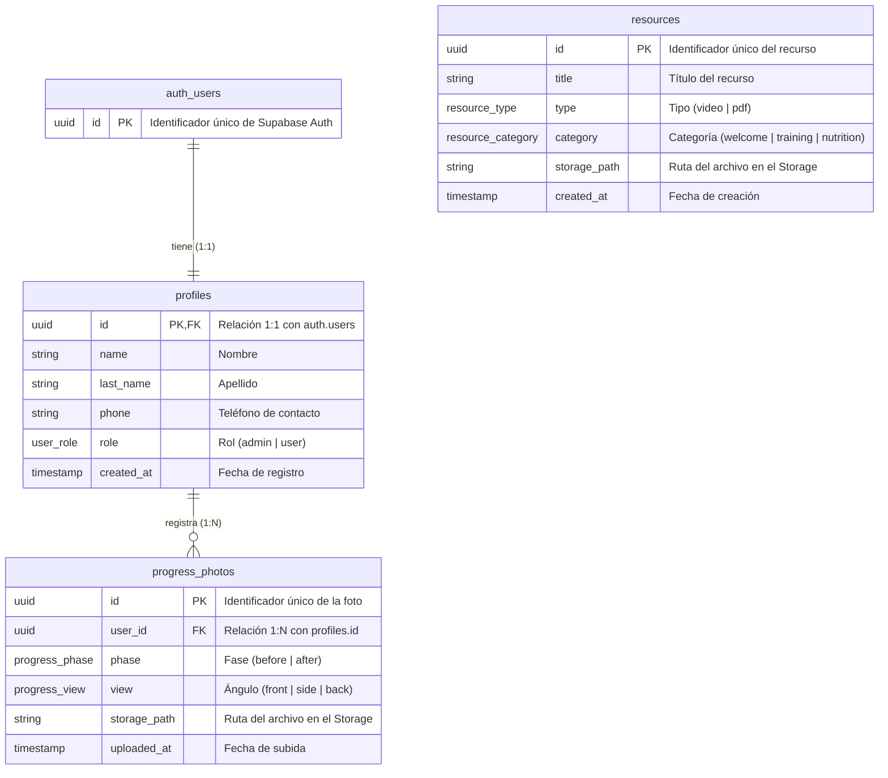

# Modelo y Diseño de Base de Datos - Top Shape

Este documento detalla el diseño de la base de datos relacional de **Top Shape**, implementada sobre **PostgreSQL** a través de **Supabase**. Se describen las tablas, tipos personalizados (ENUMs), restricciones y las relaciones entre entidades.

---

## 1. Diagrama de Relaciones (ERD)

### Visualización Mermaid


### Visualización de Relaciones (ASCII)
```text
+------------------+          +-------------------+
|    auth.users    |          |     profiles      |
|  (Supabase Auth) |          |  (Tabla Perfiles) |
+--------+---------+          +---------+---------+
         |                              |
         | (1:1 relation via id)        |
         +------------------------------+
                                        |
                                        | (1:N relation)
                                        v
                              +---------+---------+
                              |  progress_photos  |
                              |  (Fotos Progreso) |
                              +-------------------+

                              +-------------------+
                              |     resources     |
                              | (Recursos Estát.) |
                              +-------------------+
```

---

## 2. Tipos Personalizados (ENUMs)

Para asegurar la integridad de datos en el motor de base de datos, se definen los siguientes tipos enumerados:

### `user_role`
Define los niveles de acceso dentro de la aplicación.
* `admin`: Administradores con acceso total al panel de control y subida de recursos.
* `user`: Participantes activos del programa con acceso a ver recursos y subir sus fotos de progreso.

### `progress_phase`
Representa el periodo de la transformación física del participante.
* `before`: Fotografías tomadas al inicio del programa.
* `after`: Fotografías tomadas al finalizar el programa.

### `progress_view`
Define la perspectiva o ángulo visual de la captura fotográfica.
* `front`: Vista frontal del participante.
* `side`: Vista de perfil (lateral) del participante.
* `back`: Vista trasera (de espalda) del participante.

### `resource_type`
Clasifica el formato del contenido educativo o material disponible.
* `video`: Videos de entrenamiento o explicativos.
* `pdf`: Guías escritas, planes nutricionales o documentación.

### `resource_category`
Agrupa los recursos según su área temática.
* `welcome`: Material introductorio y de bienvenida.
* `training`: Guías y rutinas de ejercicio físico.
* `nutrition`: Planes alimenticios y consejos de nutrición.

---

## 3. Diccionario de Datos (Tablas)

### 3.1. Tabla: `profiles`
Almacena la información de perfil personal de los usuarios. Esta tabla extiende los datos del sistema de autenticación nativo de Supabase.

| Campo | Tipo de Datos | Restricciones | Descripción |
|---|---|---|---|
| `id` | `UUID` | `PRIMARY KEY`, `FOREIGN KEY (auth.users.id)` | Identificador del usuario. Vinculado 1:1 con el usuario autenticado. |
| `name` | `VARCHAR(100)` | `NOT NULL` | Nombre de pila del usuario. |
| `last_name` | `VARCHAR(100)` | `NOT NULL` | Apellido del usuario. |
| `phone` | `VARCHAR(20)` | `NULL` | Número telefónico de contacto. |
| `role` | `user_role` | `NOT NULL`, `DEFAULT 'user'` | Rol de acceso del usuario (`admin` o `user`). |
| `created_at` | `TIMESTAMPTZ` | `NOT NULL`, `DEFAULT now()` | Marca de tiempo de la creación del perfil. |

> [!NOTE]
> **Relación 1:1 con auth.users**:
> La tabla `profiles` está enlazada directamente con la tabla interna `auth.users` de Supabase a través del campo `id`. Cuando un usuario se registra, un trigger o la aplicación crea un registro equivalente en `profiles` con el mismo `id` generado por el módulo de autenticación.

---

### 3.2. Tabla: `progress_photos`
Registra las rutas de las imágenes que evidencian la evolución física de cada participante.

| Campo | Tipo de Datos | Restricciones | Descripción |
|---|---|---|---|
| `id` | `UUID` | `PRIMARY KEY`, `DEFAULT gen_random_uuid()` | Identificador único del registro de la foto. |
| `user_id` | `UUID` | `FOREIGN KEY (profiles.id)`, `NOT NULL` | ID del participante dueño de la foto. |
| `phase` | `progress_phase` | `NOT NULL` | Fase de la foto (`before` o `after`). |
| `view` | `progress_view` | `NOT NULL` | Perspectiva de la toma (`front`, `side` o `back`). |
| `storage_path` | `TEXT` | `NOT NULL` | Ruta relativa dentro del bucket `progress-photos` en Supabase Storage. |
| `uploaded_at` | `TIMESTAMPTZ` | `NOT NULL`, `DEFAULT now()` | Fecha y hora en la que se subió la imagen. |

#### Restricciones de Integridad
* **Clave Única Compuesta**: Se aplica la restricción de unicidad `UNIQUE(user_id, phase, view)`. Esto previene de forma estricta a nivel de base de datos que un usuario suba duplicados de la misma perspectiva para una misma etapa del proceso.

#### Estructura de las 6 Fotografías por Participante
Un participante que complete de manera exitosa el programa tendrá exactamente 6 registros en esta tabla, correspondientes a la siguiente matriz de control:

| # | Fase (`phase`) | Perspectiva (`view`) | Descripción Corta | Ruta de Almacenamiento Esperada (`storage_path`) |
|---|---|---|---|---|
| 1 | `before` | `front` | Foto frontal inicial | `{user_id}/before_front.jpg` |
| 2 | `before` | `side` | Foto de perfil inicial | `{user_id}/before_side.jpg` |
| 3 | `before` | `back` | Foto de espalda inicial | `{user_id}/before_back.jpg` |
| 4 | `after` | `front` | Foto frontal final | `{user_id}/after_front.jpg` |
| 5 | `after` | `side` | Foto de perfil final | `{user_id}/after_side.jpg` |
| 6 | `after` | `back` | Foto de espalda final | `{user_id}/after_back.jpg` |

---

### 3.3. Tabla: `resources`
Almacena el catálogo de recursos educativos, planes de entrenamiento y guías nutricionales disponibles en la plataforma.

| Campo | Tipo de Datos | Restricciones | Descripción |
|---|---|---|---|
| `id` | `UUID` | `PRIMARY KEY`, `DEFAULT gen_random_uuid()` | Identificador único del recurso. |
| `title` | `VARCHAR(255)` | `NOT NULL` | Nombre descriptivo del recurso que se mostrará al usuario. |
| `type` | `resource_type` | `NOT NULL` | Tipo de formato del archivo (`video` o `pdf`). |
| `category` | `resource_category` | `NOT NULL` | Área de clasificación (`welcome`, `training` o `nutrition`). |
| `storage_path` | `TEXT` | `NOT NULL` | Ruta del archivo dentro de los buckets correspondientes de Supabase Storage. |
| `created_at` | `TIMESTAMPTZ` | `NOT NULL`, `DEFAULT now()` | Fecha de registro y publicación del recurso. |
